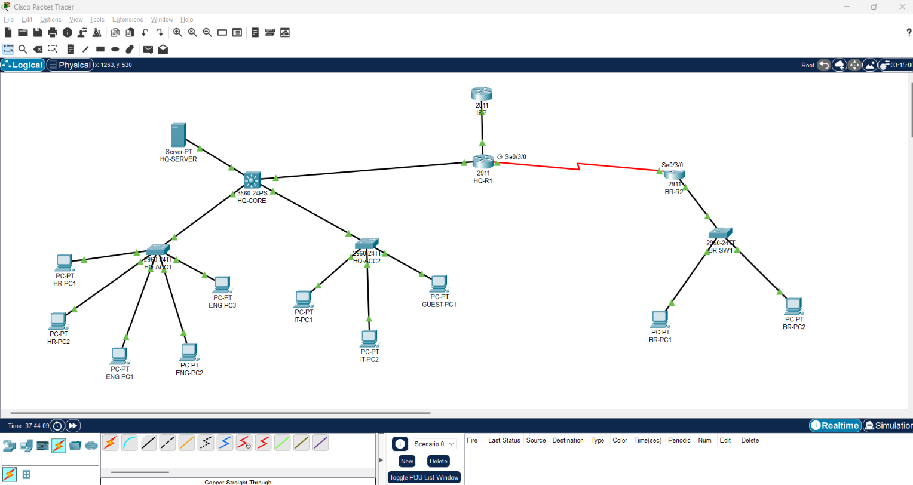
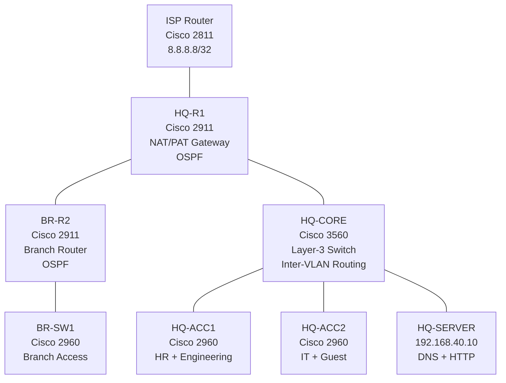

# 🏢 Enterprise Campus Network — Cisco Packet Tracer

<strong>A complete, documented enterprise-network simulation built as an E&TC networking project.</strong>

This is a complete networking portfolio project designed, configured, and verified from scratch in Cisco Packet Tracer as part of my **Electronics and Telecommunication Engineering (E&TC)** coursework. It represents a multi-department enterprise campus network for **Apex Enterprise Solutions**, connecting a Corporate Headquarters, a remote Branch Office over a serial WAN, and a simulated Internet Service Provider.

> **Project Status: Complete & Verified**  
> All design goals, switching, routing, dynamic OSPF, DHCP, server services, NAT/PAT, Guest isolation ACL, switchport security, and SSH remote management have been configured and verified directly in Cisco Packet Tracer.

## At a glance

| Area | Implementation |
|---|---|
| Network design | HQ, branch office, ISP and multi-department segmentation |
| Switching | VLANs, 802.1Q trunks, access ports and Layer-3 SVIs |
| Routing | OSPF Area 0, static default route and Router-on-a-Stick |
| Services | DHCP relay, branch DHCP, DNS and HTTP intranet server |
| Security | Guest isolation ACL, NAT/PAT, port security and SSHv2 |
| Validation | Connectivity tests, screenshots, configuration notes and troubleshooting log |

## Why this project matters

The project demonstrates the full network-engineering workflow: translate a business scenario into a topology, create an IP and VLAN plan, configure routing and services, apply layered access controls, then verify the design with repeatable tests. It also documents a real troubleshooting case where a missing default route prevented external connectivity.

---

## Final Network Topology

---

## Final Project Verification Status

Every milestone in this project has been configured and verified with live test outputs inside Cisco Packet Tracer:

| Milestone / Feature | Status | Verification Summary |
| :--- | :---: | :--- |
| **Physical Topology & Cabling** | **Complete & Verified** | All routers, switches, servers, and PCs cabled to designated ports; all link lights green. |
| **VLAN Architecture** | **Complete & Verified** | VLANs 10, 20, 30, 40, 50 on HQ; VLANs 60, 70 on Branch. |
| **Switch Trunks & Access Ports** | **Complete & Verified** | 802.1Q trunks with specific allowed VLAN lists; access ports assigned to departments. |
| **HQ Core Layer-3 Routing** | **Complete & Verified** | `ip routing` enabled, SVIs for VLANs 10–50 active, routed transit port Gi0/1 working. |
| **HQ-CORE Default Route** | **Complete & Verified** | Static route `0.0.0.0/0 via 10.255.0.2` forwards external Internet-bound traffic to `HQ-R1`. |
| **Branch Router-on-a-Stick** | **Complete & Verified** | Subinterfaces G0/0.60 and G0/0.70 configured on BR-R2 and verified UP/UP. |
| **Serial WAN Link** | **Complete & Verified** | Serial 0/3/0 link (10.0.0.0/30) between HQ-R1 and BR-R2 verified UP/UP with clock rate. |
| **OSPF Dynamic Routing** | **Complete & Verified** | OSPF process 1 Area 0 formed FULL adjacencies; branch routes learned on HQ-CORE. |
| **DHCP Services** | **Complete & Verified** | HQ-R1 serves HQ VLANs via Core DHCP relay; BR-R2 serves branch VLANs locally. Client leases verified. |
| **Intranet Server Services** | **Complete & Verified** | HQ-SERVER on static IP 192.168.40.10; DNS and HTTP on; web page verified from browser. |
| **NAT/PAT (Overload)** | **Complete & Verified** | Dynamic PAT configured on HQ-R1; live translations verified (`192.168.50.2` &rarr; `203.0.113.1` &rarr; `8.8.8.8`). |
| **Guest Isolation ACL** | **Complete & Verified** | `GUEST_ONLY_INTERNET` ACL blocks internal access (verified unreachable) while permitting Internet. |
| **Switchport Port Security** | **Complete & Verified** | Configured on HQ-ACC1, HQ-ACC2, and BR-SW1 (max 2 MACs, sticky learning, shutdown violation). |
| **SSHv2 Secure Management** | **Complete & Verified** | Configured across all routers and switches; real SSH login tested from `HR-PC1` to `HQ-ACC1`. |
| **End-to-End Connectivity** | **Complete & Verified** | All test cases pass: inter-VLAN, cross-WAN, server access, guest isolation, and Internet reachability. |
| **Troubleshooting Case Study** | **Complete & Verified** | Investigated and resolved missing default route on HQ-CORE that dropped external traffic. |

---

## Core Technologies Demonstrated

- **Layer-2 Switching**: IEEE 802.1Q trunking, trunk pruning (allowed VLANs), access port assignments, and port security (sticky MAC, violation shutdown).
- **Layer-3 Switching & Routing**: Multilayer SVI routing, routed switchports (`no switchport`), Router-on-a-Stick subinterfaces, and static default routing.
- **Dynamic Routing**: OSPFv2 (Process 1, Single Area 0) with full neighbor adjacencies and route distribution.
- **WAN Technologies**: Leased-line point-to-point serial communication using V.35 DCE/DTE clocking (`HWIC-2T`).
- **IP Infrastructure Services**: Centralized DHCP with DHCP Relay (`ip helper-address`), local branch DHCP pools, and static IP server deployment.
- **Network Security & Defense**: Extended Access Control Lists (traffic filtering and guest isolation), Port Address Translation (NAT overload), and SSHv2 encrypted device management.

---

## Documentation Guide

Detailed notes, command listings, and verification proofs are organized in the `docs/` folder:

1. [01 — Project Overview](docs/01-project-overview.md): Business scenario, design rationale, and completed project roadmap.
2. [02 — Network Topology](docs/02-topology.md): Physical cabling diagram, exact port mappings, and final topology proof.
3. [03 — Device Inventory](docs/03-device-inventory.md): Hardware catalog, modules, server, management IPs, and client IP allocations.
4. [04 — IP Addressing & Subnet Plan](docs/04-ip-addressing.md): Full VLSM subnet plan, network sizes, and gateway addresses.
5. [05 — VLAN Architecture](docs/05-vlan-architecture.md): Departmental VLANs, switchport access assignments, and 802.1Q trunks.
6. [06 — HQ Core Switch Configuration](docs/06-hq-core.md): SVI gateways, routed transit port, static default route, and Layer-3 switching.
7. [07 — Routing & WAN](docs/07-routing-and-wan.md): OSPF dynamic routing, serial WAN link, branch Router-on-a-Stick, and edge routing.
8. [08 — DHCP & Network Services](docs/08-dhcp-and-services.md): Centralized HQ DHCP with helper relay, branch local DHCP pools, and intranet server.
9. [09 — NAT & Access Control Lists](docs/09-nat-and-acls.md): Verified NAT/PAT translation table and `GUEST_ONLY_INTERNET` ACL.
10. [10 — Switchport Security](docs/10-switch-security.md): Access switch port security (sticky MAC learning, max 2 MACs, violation shutdown).
11. [11 — Secure Remote Management (SSH)](docs/11-ssh-management.md): SSHv2 setup across all devices and verified login test from HR-PC1.
12. [12 — Testing & Verification](docs/12-testing-and-verification.md): Complete verification test matrix with 100% passed test cases.
13. [13 — Troubleshooting Log](docs/13-troubleshooting.md): Real-world debugging stories, including the HQ-CORE default route investigation.

Evidence & Configs:
- [screenshots/](screenshots/README.md): Complete directory of 27 verified screenshots captured directly from Cisco Packet Tracer.
- [configs/](configs/README.md): Information regarding saved device configurations.
