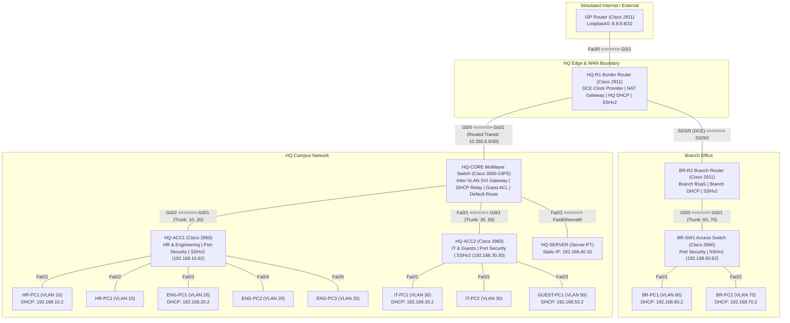
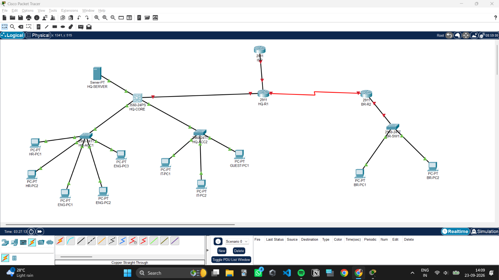
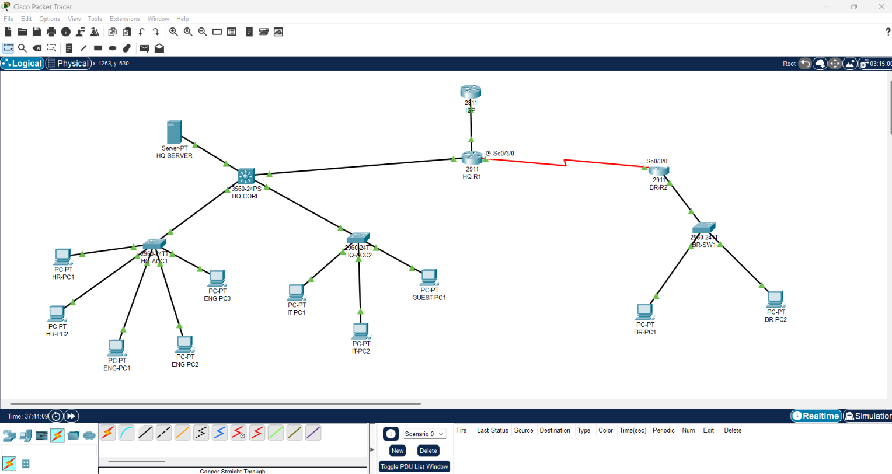

# 02 — Network Topology

## Overview

To build a clean, resilient, and manageable enterprise campus, I organized the topology into three operational zones:
1. **Headquarters (HQ)**: Core multilayer switch, access switches, internal enterprise server, and departmental PC workstations.
2. **Branch Office**: A remote satellite office with its own router, access switch, and local PCs.
3. **Simulated Internet / External**: An upstream Internet Service Provider (ISP) router connected to the HQ perimeter edge router.

All port connections listed below have been verified inside Cisco Packet Tracer.

---

## Topology Diagram

---

## Verified Interface Connection Matrix

Every single physical connection in the network was verified in Packet Tracer:

| Device A | Port A | Cable Type | Device B | Port B | Purpose / Verified Configuration |
| :--- | :--- | :--- | :--- | :--- | :--- |
| **HQ-R1** | `G0/1` | Straight-Through | **ISP** | `Fa0/0` | Simulated Internet link (`203.0.113.0/30`). NAT Outside. |
| **HQ-R1** | `S0/3/0` | Serial (DCE) | **BR-R2** | `S0/3/0` | Point-to-point WAN leased line (`10.0.0.0/30`). Clock rate 64000 on HQ-R1. |
| **HQ-R1** | `G0/0` | Straight-Through | **HQ-CORE** | `Gi0/1` | HQ campus routed transit link (`10.255.0.0/30`). OSPF Area 0. |
| **HQ-CORE** | `Gi0/2` | Straight-Through | **HQ-ACC1** | `Gi0/1` | HQ 802.1Q trunk carrying VLANs 10 and 20. |
| **HQ-CORE** | `Fa0/1` | Straight-Through | **HQ-ACC2** | `Gi0/1` | HQ 802.1Q trunk carrying VLANs 30 and 50. |
| **HQ-CORE** | `Fa0/2` | Straight-Through | **HQ-SERVER**| `FastEthernet0` | Access port in VLAN 40 (Enterprise Server). |
| **HQ-ACC1** | `Fa0/1` | Straight-Through | **HR-PC1** | `FastEthernet0` | Access port in VLAN 10 (HR). Protected by Port Security. |
| **HQ-ACC1** | `Fa0/2` | Straight-Through | **HR-PC2** | `FastEthernet0` | Access port in VLAN 10 (HR). Protected by Port Security. |
| **HQ-ACC1** | `Fa0/3` | Straight-Through | **ENG-PC1** | `FastEthernet0` | Access port in VLAN 20 (ENG). Protected by Port Security. |
| **HQ-ACC1** | `Fa0/4` | Straight-Through | **ENG-PC2** | `FastEthernet0` | Access port in VLAN 20 (ENG). Protected by Port Security. |
| **HQ-ACC1** | `Fa0/5` | Straight-Through | **ENG-PC3** | `FastEthernet0` | Access port in VLAN 20 (ENG). Protected by Port Security. |
| **HQ-ACC2** | `Fa0/1` | Straight-Through | **IT-PC1** | `FastEthernet0` | Access port in VLAN 30 (IT). Protected by Port Security. |
| **HQ-ACC2** | `Fa0/2` | Straight-Through | **IT-PC2** | `FastEthernet0` | Access port in VLAN 30 (IT). Protected by Port Security. |
| **HQ-ACC2** | `Fa0/3` | Straight-Through | **GUEST-PC1**| `FastEthernet0` | Access port in VLAN 50 (Guest). Protected by Port Security. |
| **BR-R2** | `G0/0` | Straight-Through | **BR-SW1** | `Gi0/1` | Branch 802.1Q trunk (Router-on-a-Stick for VLANs 60 & 70). |
| **BR-SW1** | `Fa0/1` | Straight-Through | **BR-PC1** | `FastEthernet0` | Access port in VLAN 60 (BR-USERS). Protected by Port Security. |
| **BR-SW1** | `Fa0/2` | Straight-Through | **BR-PC2** | `FastEthernet0` | Access port in VLAN 70 (BR-ADMIN). Protected by Port Security. |

---

## Visual Verification Evidence

### Physical Cabling Layout in Packet Tracer

### Final Converged Topology with Green Link Status

---

Next: [03 — Device Inventory](03-device-inventory.md)
