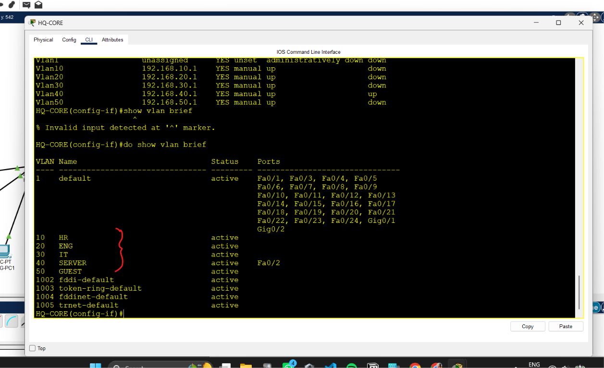
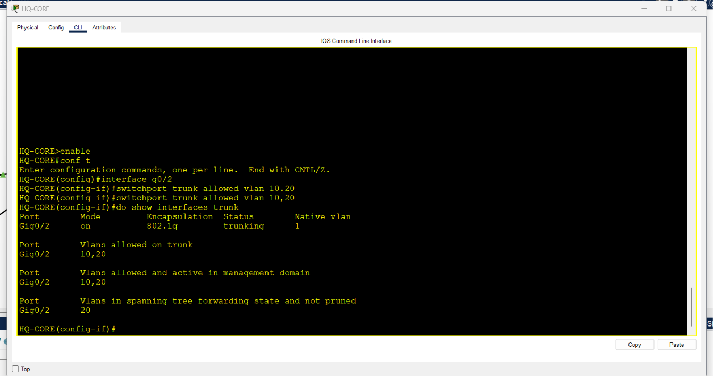

# 05 — VLAN Architecture & Switching Configuration

## Why I Divided the Network into VLANs

I divided the HQ network into separate VLANs for HR, Engineering, IT, the server room, and guests. At the branch, I created separate VLANs for users and administration. 

This keeps departmental broadcast traffic isolated, optimizes switch performance, and allows us to enforce granular security policies (such as isolating guests from internal subnets).

---

## VLAN Database

| VLAN ID | Name | Subnet | Gateway | Switch Location | Port Allocation | Status |
| :---: | :--- | :--- | :--- | :--- | :--- | :---: |
| **10** | `HR` | `192.168.10.0/26` | `192.168.10.1` | `HQ-CORE`, `HQ-ACC1` | `HQ-ACC1 Fa0/1 - Fa0/2` | **Configured & Verified** |
| **20** | `ENG` | `192.168.20.0/25` | `192.168.20.1` | `HQ-CORE`, `HQ-ACC1` | `HQ-ACC1 Fa0/3 - Fa0/5` | **Configured & Verified** |
| **30** | `IT` | `192.168.30.0/27` | `192.168.30.1` | `HQ-CORE`, `HQ-ACC2` | `HQ-ACC2 Fa0/1 - Fa0/2` | **Configured & Verified** |
| **40** | `SERVER` | `192.168.40.0/28` | `192.168.40.1` | `HQ-CORE` | `HQ-CORE Fa0/2` | **Configured & Verified** |
| **50** | `GUEST` | `192.168.50.0/24` | `192.168.50.1` | `HQ-CORE`, `HQ-ACC2` | `HQ-ACC2 Fa0/3` | **Configured & Verified** |
| **60** | `BR-USERS` | `192.168.60.0/26` | `192.168.60.1` | `BR-SW1` | `BR-SW1 Fa0/1` | **Configured & Verified** |
| **70** | `BR-ADMIN` | `192.168.70.0/26` | `192.168.70.1` | `BR-SW1` | `BR-SW1 Fa0/2` | **Configured & Verified** |

---

## Switching & Trunking Configuration

To carry multiple VLANs across single physical links between switches, I configured IEEE 802.1Q trunks with explicit allowed VLAN lists to prevent unnecessary broadcast leakage:

### 1. HQ-CORE Switch Configuration
- **Gi0/2 (Trunk to HQ-ACC1)**:
  - Mode: Trunk (`switchport trunk encapsulation dot1q`, `switchport mode trunk`)
  - Allowed VLANs: `10,20` (carries HR and Engineering traffic)
- **Fa0/1 (Trunk to HQ-ACC2)**:
  - Mode: Trunk (`switchport trunk encapsulation dot1q`, `switchport mode trunk`)
  - Allowed VLANs: `30,50` (carries IT and Guest traffic)
- **Fa0/2 (Access to HQ-SERVER)**:
  - Mode: Access (`switchport mode access`, `switchport access vlan 40`)

### 2. HQ-ACC1 Switch Configuration
- **Gi0/1 (Trunk to HQ-CORE)**:
  - Mode: Trunk (`switchport mode trunk`)
  - Allowed VLANs: `10,20`
- **Fa0/1 - Fa0/2 (HR PCs)**:
  - Mode: Access in VLAN 10 (`switchport access vlan 10`)
  - Connected to `HR-PC1` and `HR-PC2` (Protected by Port Security)
- **Fa0/3 - Fa0/5 (Engineering PCs)**:
  - Mode: Access in VLAN 20 (`switchport access vlan 20`)
  - Connected to `ENG-PC1`, `ENG-PC2`, and `ENG-PC3` (Protected by Port Security)
- **Management SVI**: `interface Vlan10` &rarr; `192.168.10.62/26`

### 3. HQ-ACC2 Switch Configuration
- **Gi0/1 (Trunk to HQ-CORE)**:
  - Mode: Trunk (`switchport mode trunk`)
  - Allowed VLANs: `30,50`
- **Fa0/1 - Fa0/2 (IT PCs)**:
  - Mode: Access in VLAN 30 (`switchport access vlan 30`)
  - Connected to `IT-PC1` and `IT-PC2` (Protected by Port Security)
- **Fa0/3 (Guest PC)**:
  - Mode: Access in VLAN 50 (`switchport access vlan 50`)
  - Connected to `GUEST-PC1` (Protected by Port Security)
- **Management SVI**: `interface Vlan30` &rarr; `192.168.30.30/27`

### 4. BR-SW1 Switch Configuration (Branch)
- **Gi0/1 (Trunk to BR-R2 Router)**:
  - Mode: Trunk (`switchport mode trunk`)
  - Allowed VLANs: `60,70`
- **Fa0/1 (Branch Users PC)**:
  - Mode: Access in VLAN 60 (`switchport access vlan 60`)
  - Connected to `BR-PC1` (Protected by Port Security)
- **Fa0/2 (Branch Admin PC)**:
  - Mode: Access in VLAN 70 (`switchport access vlan 70`)
  - Connected to `BR-PC2` (Protected by Port Security)
- **Management SVI**: `interface Vlan60` &rarr; `192.168.60.62/26`

---

## Visual Verification Evidence

### VLAN Database on HQ-CORE

### 802.1Q Trunk Status on HQ-CORE

---

Next: [06 — HQ Core Switch Configuration](06-hq-core.md)
