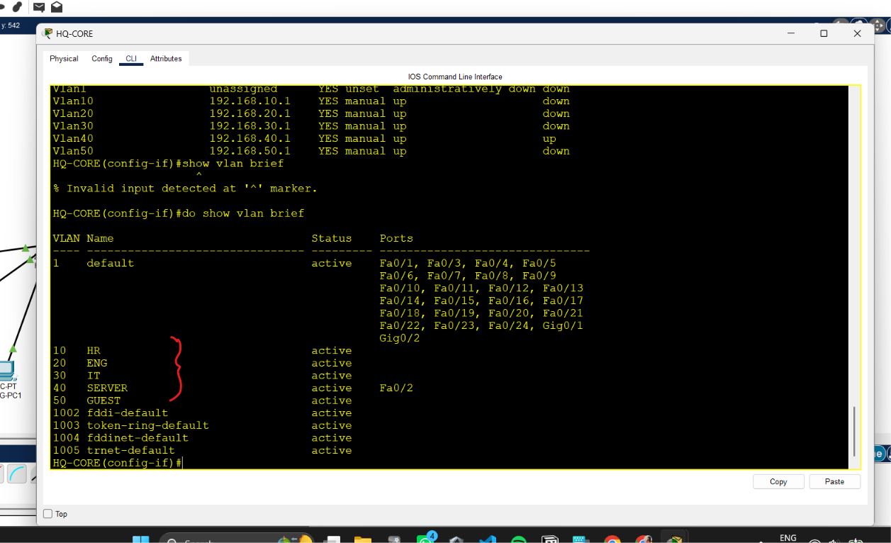
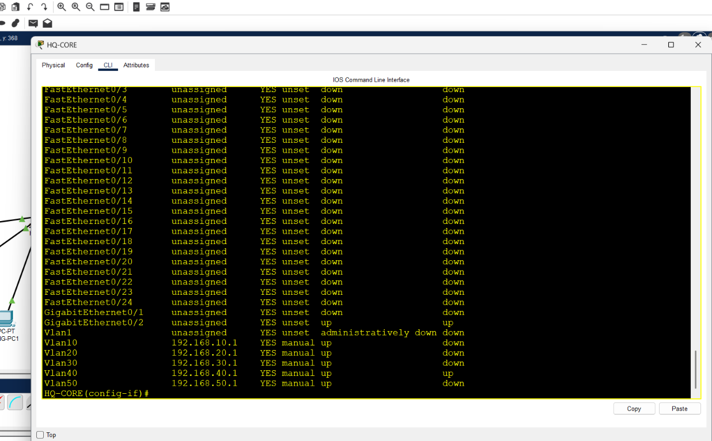
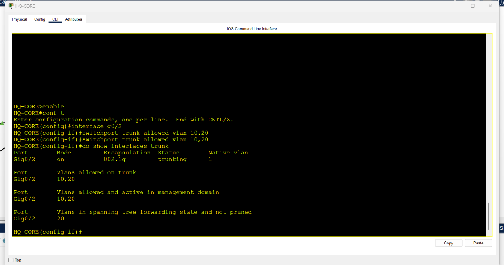
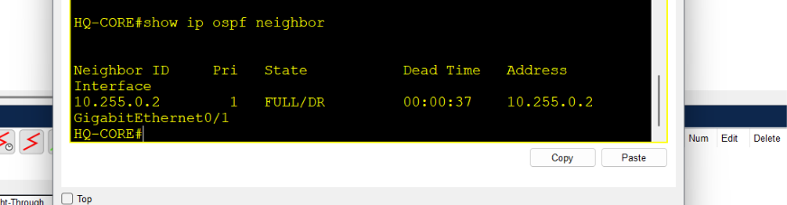
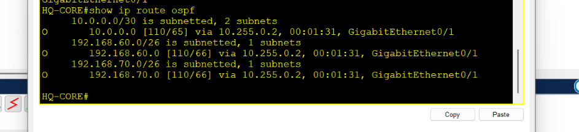

# 06 — HQ Core Switch (Cisco Catalyst 3560-24PS)

## Role of the Core Switch

The **HQ-CORE** switch is the central backbone of the headquarters campus. Because it is a Cisco Catalyst 3560 Layer-3 multilayer switch, it handles both switching and high-speed routing:

1. **Hardware Inter-VLAN Routing**: Routes between departmental VLANs directly in hardware via Switched Virtual Interfaces (SVIs) without bottlenecking an external router.
2. **Transit Routing**: Connects to the border router `HQ-R1` via a routed port (`no switchport`) using subnet `10.255.0.0/30`.
3. **Static Default Route**: Directs all unknown and Internet-bound traffic (`0.0.0.0/0`) across the transit link to `HQ-R1` (`10.255.0.2`).
4. **DHCP Relay Services**: Forwards DHCP Discover broadcasts from client VLANs to the centralized DHCP server on `HQ-R1` using `ip helper-address`.
5. **Guest Security Perimeter**: Enforces the `GUEST_ONLY_INTERNET` extended ACL on `interface Vlan50`.
6. **Dynamic Routing**: Participates in OSPF Area 0, advertising campus SVIs and dynamically learning branch routes.

---

## Completed & Verified Configurations

### 1. Enabling Layer-3 Routing
Enabled global hardware IPv4 forwarding:
```cisco
HQ-CORE(config)# ip routing
```

### 2. SVI Default Gateways, DHCP Relay & Guest ACL
Configured SVIs for each departmental VLAN. For client subnets, `ip helper-address 10.255.0.2` was added to forward DHCP requests to `HQ-R1`:

```cisco
! HR Gateway & DHCP Relay
HQ-CORE(config)# interface Vlan10
HQ-CORE(config-if)# ip address 192.168.10.1 255.255.255.192
HQ-CORE(config-if)# ip helper-address 10.255.0.2
HQ-CORE(config-if)# no shutdown

! Engineering Gateway & DHCP Relay
HQ-CORE(config)# interface Vlan20
HQ-CORE(config-if)# ip address 192.168.20.1 255.255.255.128
HQ-CORE(config-if)# ip helper-address 10.255.0.2
HQ-CORE(config-if)# no shutdown

! IT Support Gateway & DHCP Relay
HQ-CORE(config)# interface Vlan30
HQ-CORE(config-if)# ip address 192.168.30.1 255.255.255.224
HQ-CORE(config-if)# ip helper-address 10.255.0.2
HQ-CORE(config-if)# no shutdown

! Server Room Gateway (Static server - no helper needed)
HQ-CORE(config)# interface Vlan40
HQ-CORE(config-if)# ip address 192.168.40.1 255.255.255.240
HQ-CORE(config-if)# no shutdown

! Guest Gateway, DHCP Relay & Guest Security ACL
HQ-CORE(config)# interface Vlan50
HQ-CORE(config-if)# ip address 192.168.50.1 255.255.255.0
HQ-CORE(config-if)# ip helper-address 10.255.0.2
HQ-CORE(config-if)# ip access-group GUEST_ONLY_INTERNET in
HQ-CORE(config-if)# no shutdown
```

### 3. Routed Transit Link to HQ-R1
Converted `Gi0/1` into a dedicated routed point-to-point interface:
```cisco
HQ-CORE(config)# interface GigabitEthernet0/1
HQ-CORE(config-if)# no switchport
HQ-CORE(config-if)# ip address 10.255.0.1 255.255.255.252
HQ-CORE(config-if)# no shutdown
```

### 4. Static Default Route (Troubleshooting Fix)
To allow campus workstations to reach simulated Internet destinations outside our private OSPF domain, I added a static default route pointing to `HQ-R1`:
```cisco
HQ-CORE(config)# ip route 0.0.0.0 0.0.0.0 10.255.0.2
```

### 5. Guest Isolation ACL (`GUEST_ONLY_INTERNET`)
To keep visitors on VLAN 50 from reaching internal corporate resources while allowing external web access:
```cisco
HQ-CORE(config)# ip access-list extended GUEST_ONLY_INTERNET
HQ-CORE(config-ext-nacl)# deny ip 192.168.50.0 0.0.0.255 192.168.0.0 0.0.255.255
HQ-CORE(config-ext-nacl)# permit ip 192.168.50.0 0.0.0.255 any
```

### 6. OSPF Dynamic Routing
`HQ-CORE` runs OSPF process 1 in Area 0:
```cisco
HQ-CORE(config)# router ospf 1
HQ-CORE(config-router)# network 10.255.0.0 0.0.0.3 area 0
HQ-CORE(config-router)# network 192.168.10.0 0.0.0.63 area 0
HQ-CORE(config-router)# network 192.168.20.0 0.0.0.127 area 0
HQ-CORE(config-router)# network 192.168.30.0 0.0.0.31 area 0
HQ-CORE(config-router)# network 192.168.40.0 0.0.0.15 area 0
HQ-CORE(config-router)# network 192.168.50.0 0.0.0.255 area 0
```

---

## Visual Verification Evidence

### VLAN Database on HQ-CORE


### SVI Interface Status and IP Addressing


### 802.1Q Trunks Active on HQ-CORE


### OSPF Neighbor Adjacency with HQ-R1


### OSPF Learned Branch Routes on HQ-CORE


---

Next: [07 — Routing Architecture & WAN](07-routing-and-wan.md)
