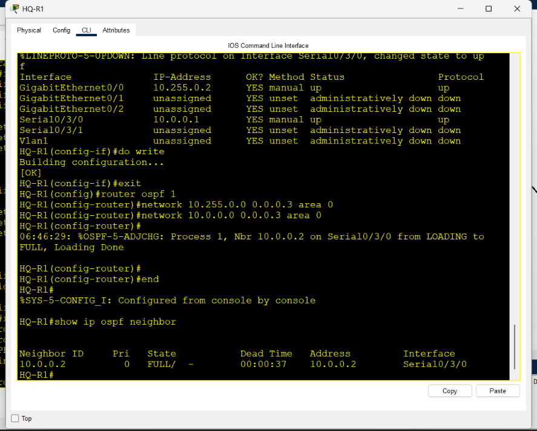
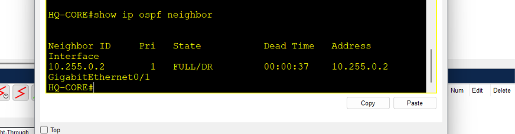
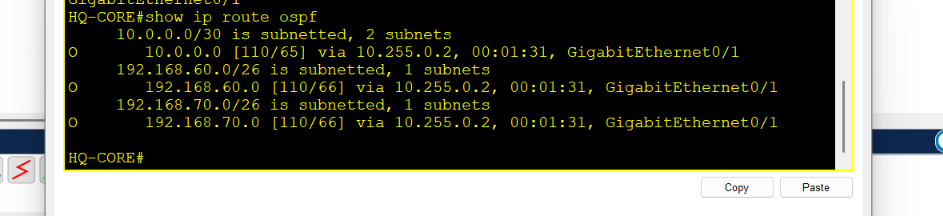
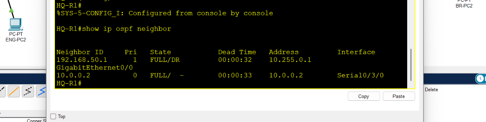

# 07 — Routing Architecture & WAN Connectivity

## How Routing Works in This Network

The enterprise routing framework uses a multi-tier approach:
1. **At HQ**: `HQ-CORE` routes between the campus VLANs in hardware and connects to `HQ-R1` across a routed transit link (`10.255.0.0/30`). A static default route on `HQ-CORE` forwards external traffic to `HQ-R1`.
2. **At the Branch**: `BR-R2` routes between the two branch VLANs using Router-on-a-Stick over a single trunk link.
3. **Across the WAN**: `HQ-R1` and `BR-R2` communicate across a serial leased line using **OSPF Area 0**, which automatically shares routes between HQ and the branch.
4. **To the Internet**: `HQ-R1` has a static default route pointed toward the ISP router.

> **Important Boundary Rule**:  
> The ISP router does **NOT** participate in our enterprise OSPF domain. The ISP represents an external public service provider. The enterprise routing domain stops at `HQ-R1 G0/1`.

---

## 1. HQ Transit Link (`HQ-CORE` &harr; `HQ-R1`)

Instead of routing all campus VLANs on `HQ-R1`, I kept inter-VLAN routing on `HQ-CORE` and created a dedicated `/30` point-to-point transit link:
- **HQ-CORE Gi0/1**: `10.255.0.1/30`
- **HQ-R1 G0/0**: `10.255.0.2/30`
- **Status**: Tested and verified with 100% ping replies.

---

## 2. Serial WAN Leased Line (`HQ-R1` &harr; `BR-R2`)

The branch office connects back to headquarters through a point-to-point serial cable:
- **Subnet**: `10.0.0.0/30`
- **HQ-R1 Serial0/3/0**: `10.0.0.1 255.255.255.252` (DCE side, configured with `clock rate 64000`)
- **BR-R2 Serial0/3/0**: `10.0.0.2 255.255.255.252` (DTE side)
- **Status**: Line protocol and interface status verified as `UP/UP`.

---

## 3. Branch Router-on-a-Stick (`BR-R2`)

Because the branch is smaller, it does not need a large multilayer switch. Instead, `BR-R2` uses **Router-on-a-Stick (RoaS)** to route between branch VLANs over a single physical link connected to `BR-SW1 Gi0/1`:

```cisco
! Turn on physical interface
BR-R2(config)# interface GigabitEthernet0/0
BR-R2(config-if)# no shutdown

! Subinterface for Branch Users (VLAN 60)
BR-R2(config)# interface GigabitEthernet0/0.60
BR-R2(config-subif)# encapsulation dot1Q 60
BR-R2(config-subif)# ip address 192.168.60.1 255.255.255.192

! Subinterface for Branch Admin (VLAN 70)
BR-R2(config)# interface GigabitEthernet0/0.70
BR-R2(config-subif)# encapsulation dot1Q 70
BR-R2(config-subif)# ip address 192.168.70.1 255.255.255.192
```

- **Status**: Both subinterfaces were verified as `UP/UP`.

---

## 4. Dynamic Routing: OSPF Area 0

To automatically share routes across HQ and the branch, I configured **OSPF process 1 in Area 0** across all three enterprise Layer-3 devices (`HQ-CORE`, `HQ-R1`, and `BR-R2`).

### OSPF Configurations:

```cisco
! HQ-R1 Border Router
HQ-R1(config)# router ospf 1
HQ-R1(config-router)# network 10.255.0.0 0.0.0.3 area 0
HQ-R1(config-router)# network 10.0.0.0 0.0.0.3 area 0

! BR-R2 Branch Router
BR-R2(config)# router ospf 1
BR-R2(config-router)# network 10.0.0.0 0.0.0.3 area 0
BR-R2(config-router)# network 192.168.60.0 0.0.0.63 area 0
BR-R2(config-router)# network 192.168.70.0 0.0.0.63 area 0

! HQ-CORE Multilayer Switch
HQ-CORE(config)# router ospf 1
HQ-CORE(config-router)# network 10.255.0.0 0.0.0.3 area 0
HQ-CORE(config-router)# network 192.168.10.0 0.0.0.63 area 0
HQ-CORE(config-router)# network 192.168.20.0 0.0.0.127 area 0
HQ-CORE(config-router)# network 192.168.30.0 0.0.0.31 area 0
HQ-CORE(config-router)# network 192.168.40.0 0.0.0.15 area 0
HQ-CORE(config-router)# network 192.168.50.0 0.0.0.255 area 0
```

### OSPF Verification:
- `HQ-R1` and `BR-R2` establish a **FULL** adjacency across the serial link.
- `HQ-CORE` and `HQ-R1` establish a **FULL** adjacency across the transit link.
- `HQ-CORE` dynamically learns the branch subnets `192.168.60.0/26` and `192.168.70.0/26` through next hop `10.255.0.2`.

---

## 5. ISP Edge & Default Routing

### Uplink to ISP:
- **Subnet**: `203.0.113.0/30`
  - `HQ-R1 G0/1`: `203.0.113.1/30`
  - `ISP Fa0/0`: `203.0.113.2/30`
- **ISP Loopback0**: `8.8.8.8/32` (simulating public Internet)

### Default Routes:
1. **On HQ-R1**:
   Points to the ISP next-hop:
   ```cisco
   HQ-R1(config)# ip route 0.0.0.0 0.0.0.0 203.0.113.2
   ```
2. **On HQ-CORE** (Troubleshooting Fix):
   Points to `HQ-R1` across the transit link so campus devices can reach external destinations:
   ```cisco
   HQ-CORE(config)# ip route 0.0.0.0 0.0.0.0 10.255.0.2
   ```

---

## Visual Verification Evidence

### OSPF Adjacency on HQ-R1


### OSPF Adjacency on HQ-CORE


### OSPF Learned Branch Routes on HQ-CORE


### Final OSPF Routing Verification Across Topology


---

Next: [08 — DHCP & Network Services](08-dhcp-and-services.md)
