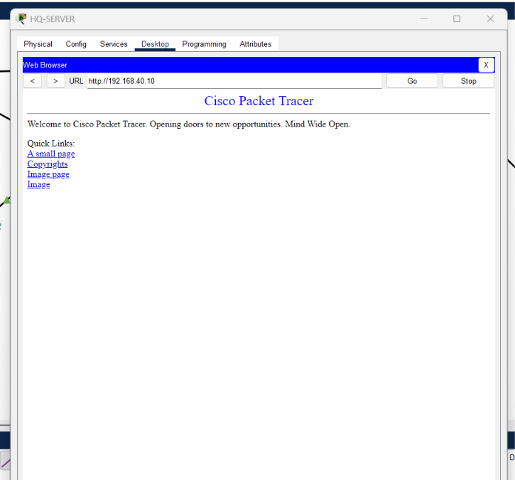
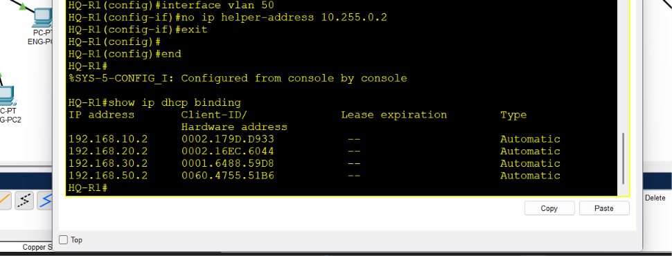
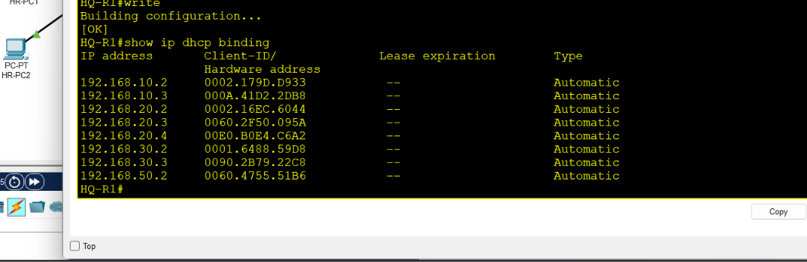
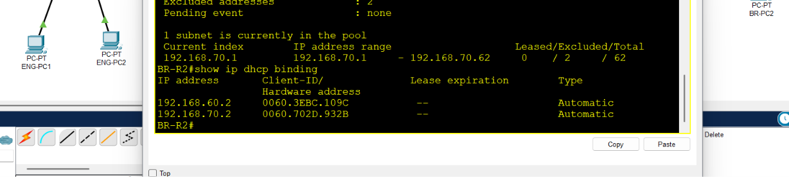
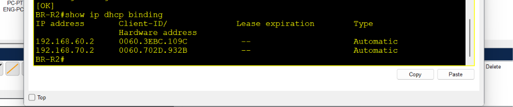
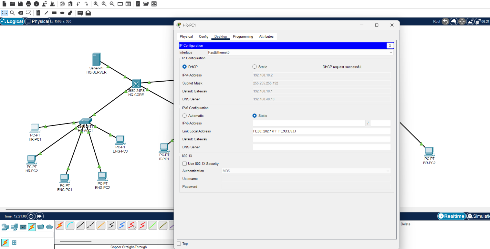
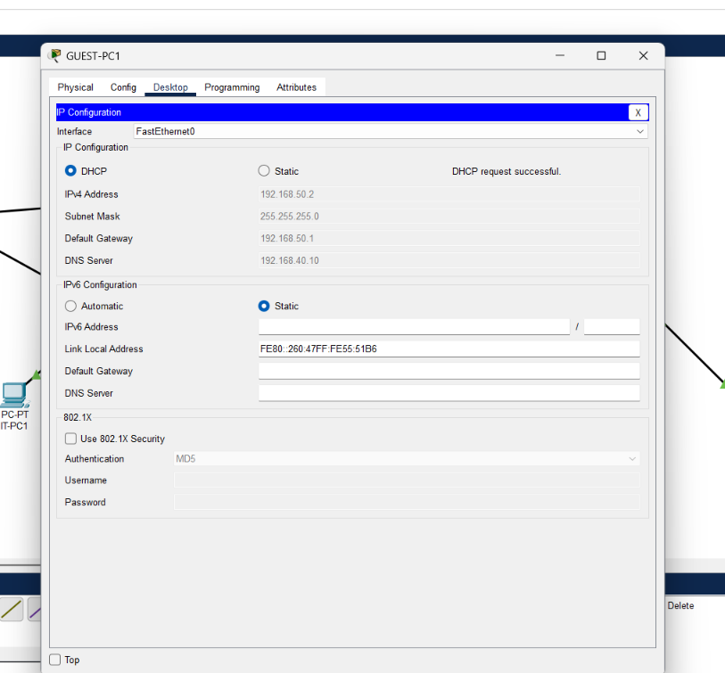
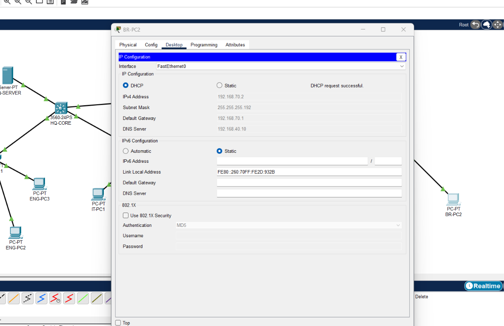

# 08 — DHCP & Network Services

## Overview

In this network, devices automatically acquire IP addresses through DHCP, and centralized intranet web and domain name services are provided by `HQ-SERVER`.

Both the DHCP architecture and enterprise server services have been fully configured and verified.

---

## 1. Local Server Setup (`HQ-SERVER`)

I set up a dedicated server in the server room (`VLAN 40`) plugged directly into `HQ-CORE Fa0/2`.

### Static IP Settings:
- **IP Address**: `192.168.40.10`
- **Subnet Mask**: `255.255.255.240` (`/28`)
- **Default Gateway**: `192.168.40.1` (HQ-CORE SVI)
- **DNS Server**: `192.168.40.10`

### Active Services:
- **DNS Service**: Enabled (`ON`)
- **HTTP Service**: Enabled (`ON`)

### Verification:
I tested the web server locally using the built-in Packet Tracer desktop web browser by navigating to `http://192.168.40.10`. The Cisco Packet Tracer welcome web page loaded successfully.



---

## 2. Headquarters DHCP Architecture (Centralized on `HQ-R1`)

Rather than configuring separate DHCP servers on every switch, `HQ-R1` acts as the centralized DHCP server for all four client VLANs at HQ. 

Because DHCP Discover packets are local Layer-2 broadcasts (destination `255.255.255.255`), they cannot cross the Layer-3 boundary on `HQ-CORE` by default. To solve this, `HQ-CORE` is configured with `ip helper-address 10.255.0.2` on each client SVI (`Vlan10`, `Vlan20`, `Vlan30`, and `Vlan50`), converting broadcasts into unicast packets directed to `HQ-R1`.

### Pools Configured on HQ-R1:

```cisco
! Excluded default gateways
HQ-R1(config)# ip dhcp excluded-address 192.168.10.1
HQ-R1(config)# ip dhcp excluded-address 192.168.20.1
HQ-R1(config)# ip dhcp excluded-address 192.168.30.1
HQ-R1(config)# ip dhcp excluded-address 192.168.50.1

! HR Pool (VLAN 10)
HQ-R1(config)# ip dhcp pool HR
HQ-R1(dhcp-config)# network 192.168.10.0 255.255.255.192
HQ-R1(dhcp-config)# default-router 192.168.10.1
HQ-R1(dhcp-config)# dns-server 192.168.40.10

! Engineering Pool (VLAN 20)
HQ-R1(config)# ip dhcp pool ENGINEERING
HQ-R1(dhcp-config)# network 192.168.20.0 255.255.255.128
HQ-R1(dhcp-config)# default-router 192.168.20.1
HQ-R1(dhcp-config)# dns-server 192.168.40.10

! IT Support Pool (VLAN 30)
HQ-R1(config)# ip dhcp pool IT
HQ-R1(dhcp-config)# network 192.168.30.0 255.255.255.224
HQ-R1(dhcp-config)# default-router 192.168.30.1
HQ-R1(dhcp-config)# dns-server 192.168.40.10

! Guest Pool (VLAN 50)
HQ-R1(config)# ip dhcp pool GUEST
HQ-R1(dhcp-config)# network 192.168.50.0 255.255.255.0
HQ-R1(dhcp-config)# default-router 192.168.50.1
HQ-R1(dhcp-config)# dns-server 192.168.40.10
```

### Verified HQ DHCP Leases:
- `HR-PC1` &rarr; `192.168.10.2` (Gateway: `192.168.10.1`)
- `ENG-PC1` &rarr; `192.168.20.2` (Gateway: `192.168.20.1`)
- `IT-PC1` &rarr; `192.168.30.2` (Gateway: `192.168.30.1`)
- `GUEST-PC1` &rarr; `192.168.50.2` (Gateway: `192.168.50.1`)

---

## 3. Branch DHCP Architecture (Local on `BR-R2`)

> **Design Choice**:  
> The branch does **not** rely on DHCP relay across the WAN to `HQ-R1`. If the serial link ever goes down, branch workstations would lose the ability to acquire IP addresses. Therefore, `BR-R2` hosts local DHCP pools directly for the branch subnets.

### Pools Configured on BR-R2:

```cisco
! Excluded default gateways
BR-R2(config)# ip dhcp excluded-address 192.168.60.1
BR-R2(config)# ip dhcp excluded-address 192.168.70.1

! Branch Users Pool (VLAN 60)
BR-R2(config)# ip dhcp pool BR-USERS
BR-R2(dhcp-config)# network 192.168.60.0 255.255.255.192
BR-R2(dhcp-config)# default-router 192.168.60.1
BR-R2(dhcp-config)# dns-server 192.168.40.10

! Branch Admin Pool (VLAN 70)
BR-R2(config)# ip dhcp pool BR-ADMIN
BR-R2(dhcp-config)# network 192.168.70.0 255.255.255.192
BR-R2(dhcp-config)# default-router 192.168.70.1
BR-R2(dhcp-config)# dns-server 192.168.40.10
```

### Verified Branch DHCP Leases:
- `BR-PC1` &rarr; `192.168.60.2` (Gateway: `192.168.60.1`)
- `BR-PC2` &rarr; `192.168.70.2` (Gateway: `192.168.70.1`)

---

## Visual Verification Evidence

### HQ DHCP Lease Bindings on HQ-R1


### Final HQ DHCP Active Pool Verification


### Branch DHCP Lease Bindings on BR-R2


### Final Branch DHCP Active Pool Verification


### HR Client PC DHCP Acquisition


### Guest Client PC DHCP Acquisition


### Branch Client PCs DHCP Acquisition


---

Next: [09 — NAT & Access Control Lists](09-nat-and-acls.md)
