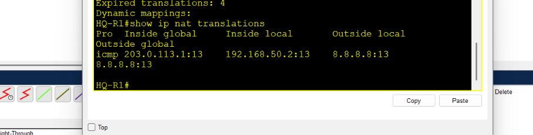
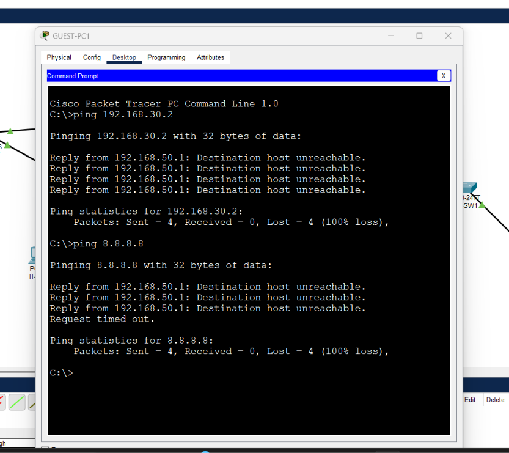
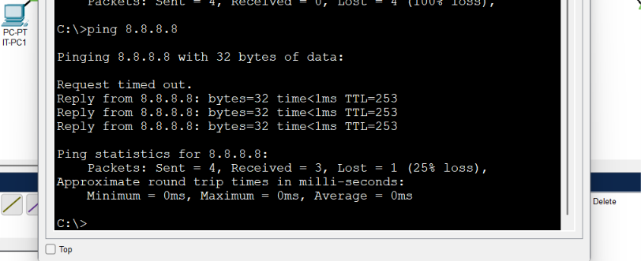

# 09 — NAT/PAT & Access Control Lists (ACLs)

## Overview

Because all internal workstations and servers use private RFC 1918 IPv4 addresses (`192.168.0.0/16`), they cannot be routed directly across the public Internet. 

This document details two vital perimeter security mechanisms that have been **fully configured and verified**:
1. **Network Address Translation with Port Address Translation (NAT/PAT Overload)** on `HQ-R1`.
2. The **Guest Isolation Extended ACL (`GUEST_ONLY_INTERNET`)** implemented on `HQ-CORE`.

---

## 1. NAT/PAT Configuration & Verification on HQ-R1

I configured `HQ-R1` to translate internal private RFC 1918 addresses to its public-facing outside interface `G0/1` using dynamic PAT (NAT Overload).

### Interface NAT Roles:
- `GigabitEthernet0/0` (LAN transit toward HQ-CORE) &rarr; `ip nat inside`
- `Serial0/3/0` (WAN link toward Branch BR-R2) &rarr; `ip nat inside`
- `GigabitEthernet0/1` (Uplink toward ISP) &rarr; `ip nat outside`

### NAT Access List & Overload Syntax:
```cisco
! Permitted internal private address space
HQ-R1(config)# access-list 1 permit 192.168.0.0 0.0.255.255

! Dynamic PAT (Overload) using outside interface G0/1
HQ-R1(config)# ip nat inside source list 1 interface GigabitEthernet0/1 overload
```

### Verification of Live NAT Translations:
When `GUEST-PC1` (`192.168.50.2`) sends packets to the simulated Internet host `8.8.8.8`, `HQ-R1` actively translates the source IP to its public IP `203.0.113.1`.

Running `show ip nat translations` on `HQ-R1` captures the live translation session:
```
Pro  Inside global         Inside local          Outside local         Outside global
icmp 203.0.113.1:1         192.168.50.2:1        8.8.8.8:1             8.8.8.8:1
```
- **Inside local**: `192.168.50.2` (the private guest client PC)
- **Inside global**: `203.0.113.1` (the public IP on HQ-R1 G0/1)
- **Outside destination**: `8.8.8.8` (simulated Internet target on ISP)

**Status: CONFIGURED AND VERIFIED.**

---

## 2. Guest Isolation ACL (`GUEST_ONLY_INTERNET`)

### Purpose & Zero-Trust Design
Office visitors connect to VLAN 50 (Guest Network). To maintain corporate confidentiality:
- Guests must be **strictly prevented** from accessing any internal corporate subnets (HR, Engineering, IT, Server Room, and Branch).
- Guests must be **permitted** to reach the external Internet (`8.8.8.8`).

### ACL Configuration on HQ-CORE:
Because `HQ-CORE` is the Layer-3 default gateway for VLAN 50, placing an extended ACL inbound on `interface Vlan50` drops unauthorized internal packets immediately before they consume routing bandwidth:

```cisco
! Create the extended ACL
HQ-CORE(config)# ip access-list extended GUEST_ONLY_INTERNET
HQ-CORE(config-ext-nacl)# deny ip 192.168.50.0 0.0.0.255 192.168.0.0 0.0.255.255
HQ-CORE(config-ext-nacl)# permit ip 192.168.50.0 0.0.0.255 any

! Apply inbound to the Guest SVI
HQ-CORE(config)# interface Vlan50
HQ-CORE(config-if)# ip access-group GUEST_ONLY_INTERNET in
```

### Verification Results:

1. **Internal Traffic Blocked (Verified)**:
   - Command on `GUEST-PC1`: `ping 192.168.30.2` (targeting `IT-PC1`)
   - **Result**: `Destination host unreachable.`
   - **Source of Unreachable**: `192.168.50.1` (HQ-CORE SVI)
   - *Analysis*: The packet was inspected and dropped right at the guest gateway, confirming that guests cannot touch internal departments.

2. **External Internet Traffic Permitted (Verified)**:
   - Command on `GUEST-PC1`: `ping 8.8.8.8` (simulated Internet target on ISP)
   - **Result**: 100% ICMP replies returned successfully after fixing the missing `HQ-CORE` default route.

---

## Visual Verification Evidence

### Verified Live NAT/PAT Translation Table on HQ-R1


### Guest ACL Blocking Internal Access (`Destination host unreachable`)


### Guest Internet Access Success to 8.8.8.8


---

Next: [10 — Switchport Security](10-switch-security.md)
