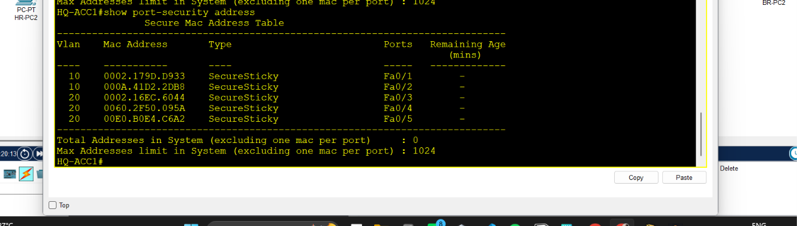
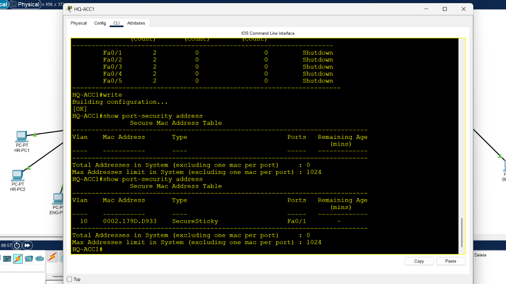
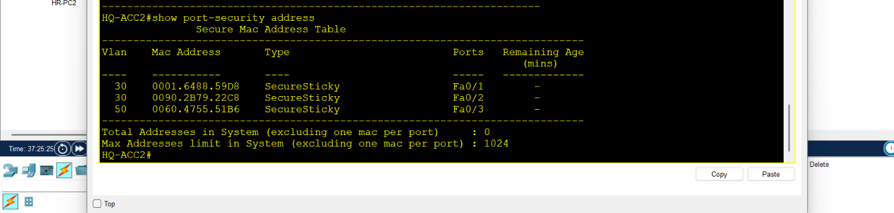
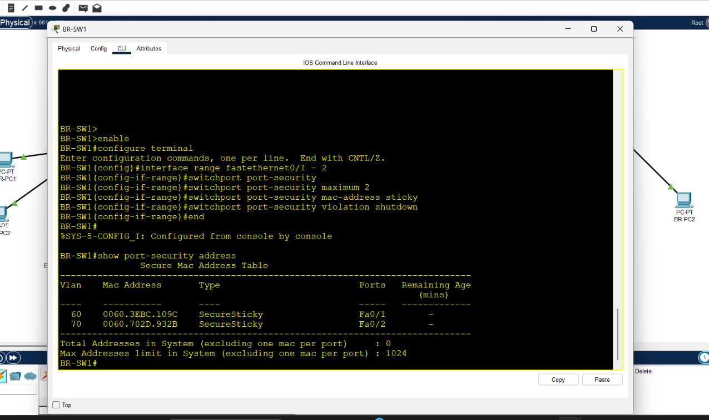
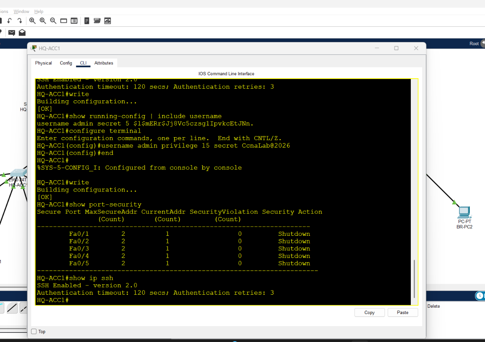

# 10 — Switchport Security & Access Layer Hardening

## Overview

Physical access ports on switches represent a primary attack surface in a campus network. If left unprotected, unauthorized rogue laptops or switches can be plugged in, causing MAC address table flooding, rogue DHCP attacks, or unauthorized network access.

To protect the Layer-2 edge, I configured and verified **Cisco Port Security** across all access switches (`HQ-ACC1`, `HQ-ACC2`, and `BR-SW1`).

**Status: COMPLETE AND VERIFIED.**

---

## Port Security Configuration Baseline

Across all user-facing edge ports, the following security baseline was deployed:
- **Switchport Mode**: Static Access (`switchport mode access`)
- **Port Security Activation**: Enabled (`switchport port-security`)
- **Maximum MAC Limit**: Set to **2** MAC addresses (`switchport port-security maximum 2`)
- **MAC Learning Mechanism**: Sticky MAC learning (`switchport port-security mac-address sticky`)
- **Violation Action**: Shutdown (`switchport port-security violation shutdown`)

### Configuration Template:
```cisco
Switch(config)# interface range FastEthernet0/1 - <N>
Switch(config-if-range)# switchport mode access
Switch(config-if-range)# switchport port-security
Switch(config-if-range)# switchport port-security maximum 2
Switch(config-if-range)# switchport port-security mac-address sticky
Switch(config-if-range)# switchport port-security violation shutdown
```

---

## Switchport Allocations & Verification Details

### 1. HQ-ACC1 (HR & Engineering Switch)
- **Protected Ports**:
  - `Fa0/1` (Connected to `HR-PC1`)
  - `Fa0/2` (Connected to `HR-PC2`)
  - `Fa0/3` (Connected to `ENG-PC1`)
  - `Fa0/4` (Connected to `ENG-PC2`)
  - `Fa0/5` (Connected to `ENG-PC3`)
- **Verification**: Running `show port-security interface <port>` or `show port-security address` confirms all five ports have dynamically learned their respective PC hardware addresses as `SecureSticky` entries. Port status is `Secure-up`.

### 2. HQ-ACC2 (IT & Guest Switch)
- **Protected Ports**:
  - `Fa0/1` (Connected to `IT-PC1`)
  - `Fa0/2` (Connected to `IT-PC2`)
  - `Fa0/3` (Connected to `GUEST-PC1`)
- **Verification**: All three ports are operational in `Secure-up` status with learned `SecureSticky` MAC addresses.

### 3. BR-SW1 (Branch Switch)
- **Protected Ports**:
  - `Fa0/1` (Connected to `BR-PC1`)
  - `Fa0/2` (Connected to `BR-PC2`)
- **Verification**: Both access ports have learned and locked their client PC hardware addresses into the running configuration as `SecureSticky`.

---

## How Sticky MAC Learning & Shutdown Violation Work

1. **Sticky Learning**: When a PC transmits its first frame (such as an ARP request or DHCP Discover), the switch registers the source MAC address and permanently binds it to that port (`mac-address sticky`).
2. **Violation Action (Shutdown)**: If an unauthorized device or network tap with a different MAC address connects to the port and exceeds the maximum limit of 2, the switch immediately places the port into an `err-disabled` state, shutting down the physical interface and alerting administrators.

---

## Visual Verification Evidence

### HQ-ACC1 Port Security Verification (Fa0/1 - Fa0/5)


### HQ-ACC1 Detailed Sticky MAC Output


### HQ-ACC2 Port Security Verification (Fa0/1 - Fa0/3)


### BR-SW1 Port Security Verification (Fa0/1 - Fa0/2)


### SSH & Port Security Status on Switch


---

Next: [11 — Secure Remote Management (SSH)](11-ssh-management.md)
