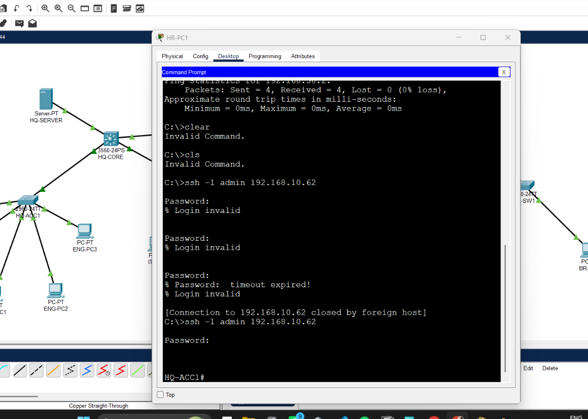
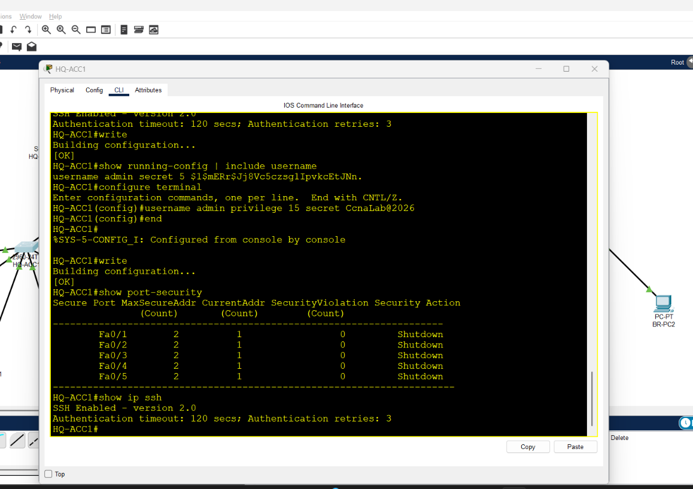

# 11 — Secure Remote Management (SSHv2)

## Overview

In an enterprise network, unencrypted management protocols like Telnet (TCP Port 23) must be strictly disabled because they send usernames, passwords, and device configurations in cleartext over the wire.

To secure administrative access across the entire infrastructure, I configured **Secure Shell version 2 (SSHv2)** on all routers and switches.

**Status: COMPLETE AND VERIFIED.**

---

## Secure Management Baseline

The following configuration was deployed across `HQ-R1`, `BR-R2`, `HQ-ACC1`, `HQ-ACC2`, and `BR-SW1`:

1. **Configured Hostname and Domain Name**:
   ```cisco
   Device(config)# ip domain-name apex.local
   ```
2. **Local Administrator Account**:
   Created a privileged local administrator user (`admin` with privilege level 15) using an encrypted secret. *(Note: Actual passwords are intentionally omitted for security reasons).*
   ```cisco
   Device(config)# username admin privilege 15 secret <ENCRYPTED_SECRET>
   ```
3. **Cryptographic RSA Key Generation**:
   Generated a 1024-bit RSA modulus key pair to handle secure key exchange:
   ```cisco
   Device(config)# crypto key generate rsa
   ! Key modulus: 1024
   ```
4. **Protocol Version Lock**:
   Enforced SSH version 2 to prevent protocol downgrade attacks:
   ```cisco
   Device(config)# ip ssh version 2
   ```
5. **VTY Line Hardening (SSH Only & Local Login)**:
   Locked Virtual Teletype lines strictly to SSH and mandated local database authentication:
   ```cisco
   Device(config)# line vty 0 4
   Device(config-line)# transport input ssh
   Device(config-line)# login local
   ```

---

## Switch Management IP Allocations

To allow administrators to reach switches across the routed campus, dedicated Switched Virtual Interfaces (SVIs) and default gateways were provisioned:

| Switch Chassis | Management SVI Interface | Management IP Address | Subnet Mask | Default Gateway |
| :--- | :--- | :--- | :--- | :--- |
| **HQ-ACC1** | `interface Vlan10` | `192.168.10.62` | `255.255.255.192` (`/26`) | `192.168.10.1` |
| **HQ-ACC2** | `interface Vlan30` | `192.168.30.30` | `255.255.255.224` (`/27`) | `192.168.30.1` |
| **BR-SW1** | `interface Vlan60` | `192.168.60.62` | `255.255.255.192` (`/26`) | `192.168.60.1` |

---

## Live SSH Login Verification Test

A real remote SSH session was initiated directly inside Packet Tracer from `HR-PC1` to `HQ-ACC1`:

```
C:\> ssh -l admin 192.168.10.62
Open
Password: ********

HQ-ACC1#
```

### Verification Observations:
1. **Encrypted Tunnel**: The connection established over TCP port 22.
2. **Local Authentication**: The local `admin` credential was verified.
3. **Privileged Access**: The session successfully landed in privileged EXEC mode (`HQ-ACC1#`).
4. **Telnet Lockout**: Attempts to establish cleartext Telnet connections are rejected by the VTY lines.

---

## Visual Verification Evidence

### Successful SSH Login from HR-PC1 to HQ-ACC1


### Switch Configuration Showing SSH & Port Security Verification


---

Next: [12 — Testing & Verification](12-testing-and-verification.md)
