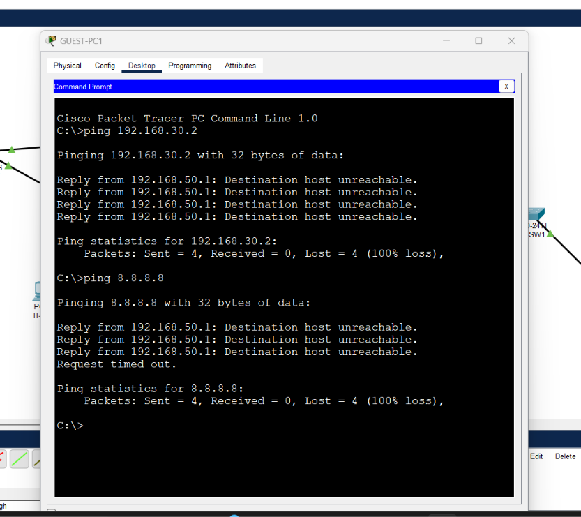
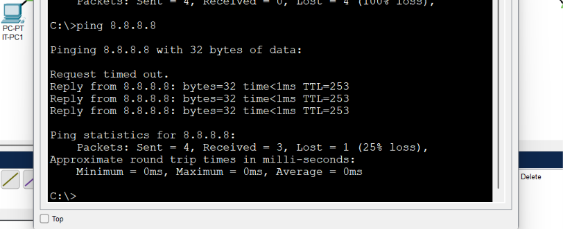
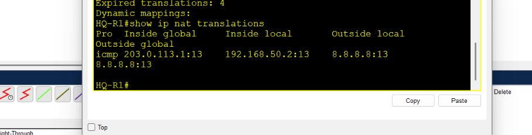

# 13 — Troubleshooting Log & Build Notes

## Overview

As I built this network in Cisco Packet Tracer, I ran into several real issues. Documenting what broke, how I investigated it, and how I fixed it is an important part of learning network engineering.

Here are the real engineering issues I encountered and resolved during this project.

---

## Resolved Issues

### 1. Case Study: Guest Internet Ping Failing (Missing Default Route on HQ-CORE)

- **The Problem**:
  After applying the `GUEST_ONLY_INTERNET` ACL on `HQ-CORE`, I tested it from `GUEST-PC1`.
  - Testing against internal IP `192.168.30.2` (`IT-PC1`): The ping failed with `Destination host unreachable`, which was the intended security behavior.
  - Testing against external simulated Internet IP `8.8.8.8`: The ping timed out completely. Guest users had no Internet connectivity.

- **Investigation**:
  1. **Checked HQ-R1 Default Route**: I ran `show ip route` on the edge router `HQ-R1`. The static default route `0.0.0.0/0 via 203.0.113.2` existed and was active toward the ISP.
  2. **Checked HQ-R1 NAT Status**: I checked NAT translations and statistics on `HQ-R1`. There were **zero translations**. This was a crucial clue: traffic destined for `8.8.8.8` wasn't even reaching `HQ-R1` in the first place.
  3. **Checked HQ-CORE Routing Table**: I queried `HQ-CORE` for a route to `0.0.0.0/0`:
     ```cisco
     HQ-CORE# show ip route 0.0.0.0
     % Network not in table
     ```
     `HQ-CORE` had routes for all the internal subnets and the branch via OSPF, but it had **no gateway of last resort**.

- **Root Cause**:
  When `GUEST-PC1` sent packets to `8.8.8.8`, the ACL on `HQ-CORE` permitted them. But when `HQ-CORE` tried to route the packet, it looked up `8.8.8.8` in its routing table, found no matching route and no default route, and silently dropped the packet.

- **How I Fixed It**:
  I added a static default route on `HQ-CORE` pointing across the transit link to `HQ-R1`:
  ```cisco
  HQ-CORE(config)# ip route 0.0.0.0 0.0.0.0 10.255.0.2
  ```

- **Retest & Verification**:
  I returned to `GUEST-PC1` and ran `ping 8.8.8.8` again.
  The ping returned 100% successful replies immediately! `HQ-CORE` now forwards unknown/Internet-bound packets to `HQ-R1`, which translates them and forwards them to the ISP.





---

### 2. Missing Serial Interfaces on Cisco 2911 Routers
- **The Issue**: When I placed `HQ-R1` and `BR-R2` into the workspace, they only had GigabitEthernet ports (`G0/0`, `G0/1`, `G0/2`). I couldn't connect a serial cable between them.
- **Why It Happened**: Cisco 2911 ISR routers are modular and don't come with built-in serial ports.
- **How I Fixed It**:
  1. Clicked on each router and powered it off in Packet Tracer.
  2. Dragged the `HWIC-2T` (2-Port Serial WAN Interface Card) into Slot 0.
  3. Turned the routers back on.
  4. Ran `show ip interface brief` in the CLI to confirm `Serial0/3/0` and `Serial0/3/1` were detected.

---

### 3. Core Switch Not Routing Between VLANs
- **The Issue**: After creating the SVIs on `HQ-CORE` for VLANs 10 through 50, traffic was not being routed between the subnets.
- **Why It Happened**: Cisco 3560 multilayer switches act purely as Layer-2 switches by default. The Layer-3 routing engine is turned off until explicitly enabled.
- **How I Fixed It**:
  1. Entered global configuration mode on `HQ-CORE`.
  2. Issued `ip routing`.
  3. Checked `show ip route` to confirm that the connected SVI routes now appeared in the routing table.

---

### 4. Identifying the Exact Switchport for the Server and Downlinks
- **The Issue**: When configuring access ports and trunks on `HQ-CORE`, I needed to be 100% sure which cable was plugged into which switch and device.
- **Why It Happened**: Connecting a trunk or access port to the wrong physical interface causes VLAN mismatches or breaks connectivity completely.
- **How I Fixed It**:
  1. Ran `show cdp neighbors` on `HQ-CORE`.
  2. Verified that `HQ-ACC1` was connected to `Gi0/2`, and `HQ-ACC2` was connected to `Fa0/1`.
  3. Checked the remaining connected cable and confirmed that `HQ-SERVER` was plugged directly into `Fa0/2`.
  4. Configured `Fa0/2` as an access port in VLAN 40.

---

### 5. Serial Link Down (Clock Rate Requirement)
- **The Issue**: After configuring IP addresses on `HQ-R1 S0/3/0` and `BR-R2 S0/3/0`, the serial line protocol was not coming up.
- **Why It Happened**: Back-to-back serial connections require one side to act as DCE and provide the clock synchronization signal.
- **How I Fixed It**:
  1. Verified that the DCE end of the cable was plugged into `HQ-R1`.
  2. Configured `clock rate 64000` under `interface Serial0/3/0` on `HQ-R1`.
  3. Ran `show ip interface brief` and confirmed the interface came up to `UP/UP`.

---

## Helpful Verification Commands I Used

```cisco
! Check interface status and IPs
show ip interface brief

! Check VLANs and assigned access ports
show vlan brief

! Check active 802.1Q trunks
show interfaces trunk

! Check OSPF neighbors and adjacency state
show ip ospf neighbor

! Check routing table and default routes
show ip route

! Check DHCP bindings
show ip dhcp binding

! Check NAT translation table
show ip nat translations

! Check access-list hit counts
show access-lists

! Check port-security status
show port-security interface <port>
```
